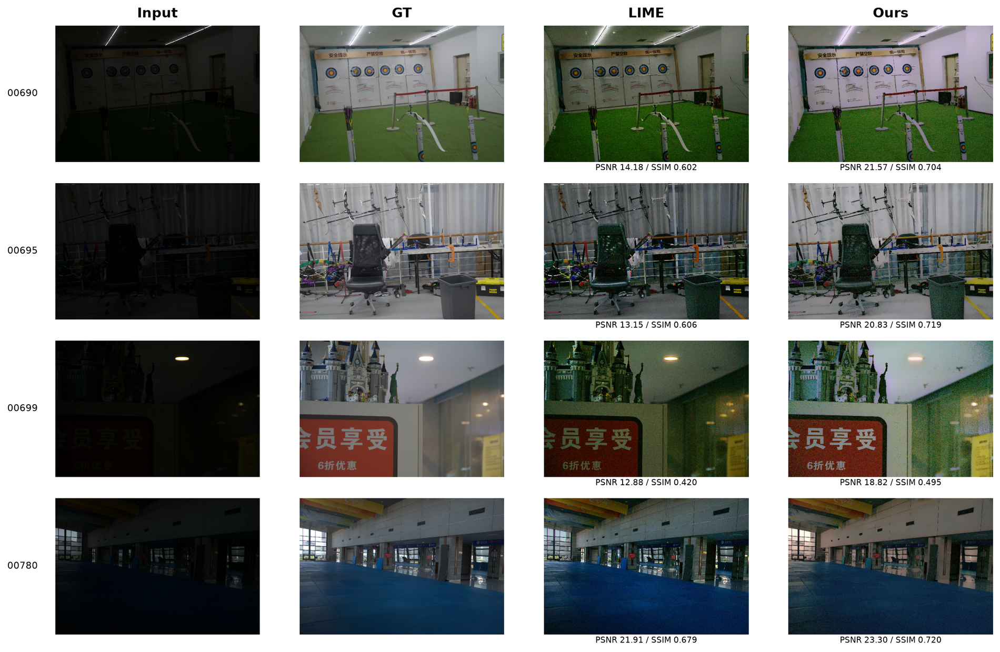
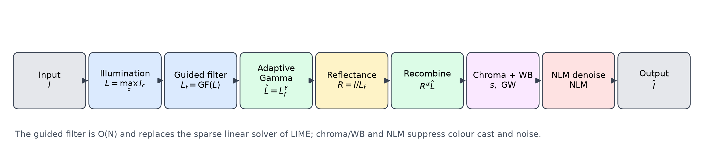
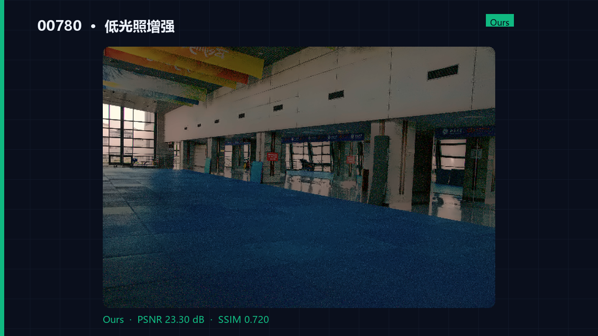

# 低光照图像增强 · Guided-Filter Retinex

一个**无需训练、可在 CPU 上运行**的低光照图像增强项目。以开源 LIME 为基线，用自引导滤波替代稀疏线性求解，并加入自适应 Gamma、色度控制、灰度世界白平衡、曝光校准和非局部均值去噪。



## 结果速览

在 LOLv2-real 的 100 对测试图像（600×400）上：

| 方法 | PSNR (dB) ↑ | SSIM ↑ | 单张耗时 (ms) |
|---|---:|---:|---:|
| LIME（基线） | 17.14 | 0.6465 | 3456 |
| **Ours** | **19.76** | **0.6727** | **588** |

相比 LIME：PSNR 提升 **+2.62 dB**，速度快约 **5.9 倍**。完整对比（Gamma / CLAHE / MSRCR / LIME / Ours）见 `results/summary.json` 与报告。

## 方法

```text
Input -> max-channel illumination -> guided filter -> adaptive gamma
      -> reflectance I/L -> R^alpha * L_hat -> chroma control -> gray-world WB
      -> exposure cap -> NLM denoise -> Output
```

- **光照估计**：`L = max_c(I_c)`，再用自引导滤波平滑。盒式滤波实现，复杂度 O(N)，保留边缘。
- **自适应 Gamma**：由光照均值反推 γ，并限制在 [0.35, 0.85]，再按 99.5% 分位数做高光安全归一化。
- **色度控制**：向逐像素均值插值，抑制 Retinex 过饱和。
- **白平衡**：灰度世界假设，强度 0.5，抑制室内灯光偏色。
- **曝光校准**：输出均值超过 0.40 时按比例回拉，避免低对比度场景被局部 Retinex 提得过亮。
- **去噪**：OpenCV fastNlMeansDenoisingColored，h=4。



## 快速开始

```powershell
python -m venv .venv
.\.venv\Scripts\activate
pip install -r requirements.txt

# 1) 单张图片（仓库自带示例，无需下载数据）
python enhance.py assets/samples/00690_input.png -o outputs/00690_ours.png

# 2) 图形界面前后对比
python app/gui.py

# 3) 下载 LOLv2-real 完整训练集 + 测试集
python scripts/download_data.py
```

批量处理：

```powershell
python enhance.py --input-dir photos/ --output-dir enhanced/ --method ours
```

## 复现实验

```powershell
# 下载完整数据，构建亮度匹配验证集并在其上选参
python scripts/download_data.py
python scripts/select_validation.py
python scripts/tune_matched.py

# 100 对测试图像上的主实验
python -m src.benchmark --split Test --methods input,gamma,clahe,msrcr,lime,ours `
    --config results/best_config.json --out results/metrics.csv --summary results/summary.json

# 消融 + 图表 + 报告
python scripts/run_ablation.py
python scripts/make_figures.py
python scripts/make_report.py
```

## 演示视频

[](report/演示视频.mp4)

无声演示，约 51 秒，1280×720：标题 → 问题 → 方法流程 → 4 组前后对比 → 结果 → 复现。

## 项目结构

```text
lowlight-retinex/
  enhance.py                 # CLI
  src/retinex.py             # 本文方法
  src/baselines.py           # Gamma / CLAHE / MSRCR / LIME / DUAL
  src/metrics.py             # PSNR / SSIM / LOE / colorfulness / entropy / gradient
  src/benchmark.py           # 批量评测
  third_party/lime/          # LIME 基线（MIT，兼容性修复）
  scripts/download_data.py   # 数据下载
  scripts/select_validation.py # 构建亮度匹配验证集
  scripts/tune_matched.py    # 验证集选参
  scripts/run_ablation.py    # 消融
  scripts/make_figures.py    # 绘图
  scripts/make_report.py     # 生成 docx 报告
  scripts/make_video.py      # 生成无声演示视频
  app/gui.py                 # Tkinter GUI
  assets/samples/            # 两对示例图片
  results/                   # 指标与图表
  report/                    # 课程报告、PDF、演示视频、封面
```

## 数据与许可证

- 数据：LOLv2-real（Apache-2.0），来源 [Hugging Face](https://huggingface.co/datasets/okhater/lolv2-real)，引用 Chen et al., CVPR 2021。数据不纳入 git。
- 代码：MIT。第三方 LIME 代码来自 [pvnieo/Low-light-Image-Enhancement](https://github.com/pvnieo/Low-light-Image-Enhancement)，MIT，许可证见 `third_party/lime/LICENSE`。

## 已知局限

- 灰度世界白平衡在强色光/单色场景下可能误判，导致偏灰。
- NLM 的 h 是全局常数，强噪声与细纹理区域难以同时兼顾。
- 定量评测仅覆盖 LOLv2-real；真实手机夜景/监控视频需要额外验证。

## 引用

如果这个项目对你有帮助，请引用：

```bibtex
@misc{lowlight_retinex_2026,
  title  = {Low-light Image Enhancement with Guided-Filter Retinex},
  author = {樊恩旭},
  year   = {2026},
  url    = {https://github.com/<your-account>/lowlight-retinex}
}
```
